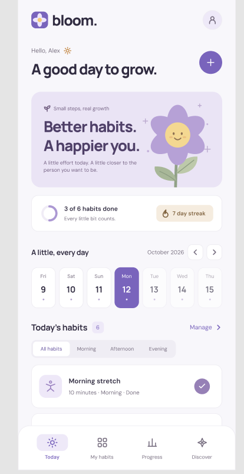
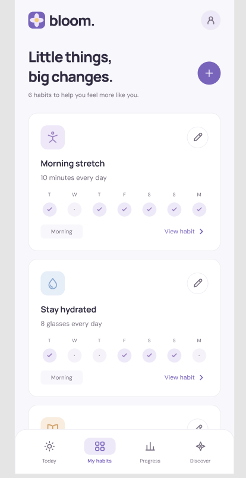
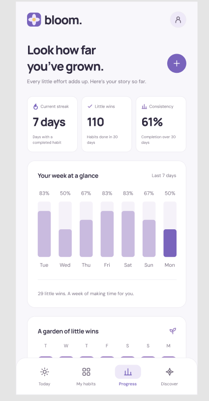
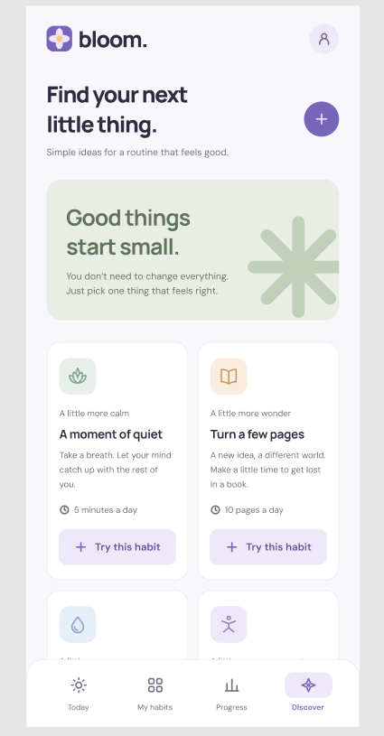

<div align="center">

# 🌱 Bloom Habit Tracker

### *Small steps, real growth.*

A local-first habit tracker built with Flutter — offline by design, no accounts, no backend.
Your habits never leave your device.

[](https://flutter.dev)
[](https://dart.dev)
[](https://bloclibrary.dev)
[](https://pub.dev/packages/hive_ce)
[](https://github.com/MohamedRamadan222/bloom_habits_tracker_app)
[](https://github.com/MohamedRamadan222/bloom_habits_tracker_app)
[](https://github.com/MohamedRamadan222/bloom_habits_tracker_app)
[](LICENSE)

</div>

---

## ✨ Features

| | |
|---|---|
| 📅 **Today tab** | Greeting with your saved name, daily progress ring, streak pill, 7-day calendar strip, period filters (All / Morning / Afternoon / Evening), one-tap habit toggle |
| 🗂️ **My Habits** | Overview cards with per-habit 7-day dots, full edit / delete with confirm dialog |
| 📊 **Progress** | Weekly completion ring, streak stats, per-day bars, per-habit week strips |
| 🔍 **Discover** | One-tap starter habits (hydration, reading, movement…) to get going in seconds |
| 🔢 **Partial progress** | Log `5/8 glasses`, not just done / not-done, via a stepper sheet |
| 🔒 **Local-first** | Hive persistence (`habits` + `logs` boxes), UUID identities — works fully offline |
| 🛡️ **Crash-safe storage** | Total parsers, corrupt-row filtering, garbage-log tolerance, index guards |

## 📸 Screenshots

> Drop your captures into [`screenshots/`](screenshots/) with the names below — the layout picks them up automatically.

<table>
  <tr>
    <td align="center"><b>Today</b></td>
    <td align="center"><b>My Habits</b></td>
    <td align="center"><b>Progress</b></td>
    <td align="center"><b>Discover</b></td>
  </tr>
  <tr>
    <td></td>
    <td></td>
    <td></td>
    <td></td>
  </tr>
</table>

## 🛠️ Tech Stack

| Layer | Choice |
|---|---|
| UI | Flutter 3.47 (Material 3, Manrope) |
| State | `flutter_bloc` — **Cubits only**, thin, use-case driven |
| Architecture | Clean Architecture: `entities` → repository interface → `use-cases` → Hive datasource, composed in `main()` via `get_it` |
| Storage | `hive_ce` + `hive_ce_flutter` (boxes: `habits`, `logs`, `settings`) |
| Dates | `intl` |
| Icons / spacing | `lucide_icons_flutter`, `gap` |
| IDs | `uuid` v4 (collision-proof, never timestamps) |
| Tests | `flutter_test`, `bloc_test`, `mocktail` |

```
lib/
├── core/
│   ├── constants/      # icons, periods, palette
│   ├── data/           # HabitModel, HabitsRepositoryImpl, SettingsDatasource
│   ├── di/             # get_it composition root
│   ├── domain/         # entities, repository interface, use-cases
│   ├── theme/          # AppColors tokens + AppTheme
│   └── widgets/        # shared UI (calendar, rings, headers)
├── features/
│   ├── home/           # Today tab + HomeCubit
│   ├── habits/         # My Habits tab + HabitsCubit
│   ├── progress/       # Progress tab + ProgressCubit
│   ├── discover/       # Discover tab (static starters)
│   └── main_layout.dart
└── main.dart
```

**Design tokens:** every color in the UI comes from `AppColors` — zero hardcoded hexes in widgets.

## ✅ Testing — 93.2% coverage on core logic

46 tests, all green. No boilerplate: each test pins a real contract.

| Suite | What it proves |
|---|---|
| `test/data/habits_repository_test.dart` | Hive round-trip, negative clamp, delete cascades logs, garbage-key tolerance, 2-day streak, gap reset, future-log ignore, week matrix, future-created filter, legacy int-ID migration |
| `test/features/home_cubit_test.dart` | Startup load, tab filter without reload, add/toggle/update/delete delegation, username save, error → `error` state |
| `test/features/habits_cubit_test.dart` | Week load, add → reload |
| `test/features/progress_cubit_test.dart` | Empty-store zeros (no div-by-zero), win/streak math |
| `test/domain/` | `dayKey`/`lastDays` date math, entity validity, all 10 use-cases |
| `test/widgets/` + `test/widget_test.dart` | Habit-card toggle contract, full-app navigation renders 4 tabs |

```
flutter test                                    # run all 46 tests
flutter test --coverage                         # regenerate coverage/lcov.info
```

| Scope | Line coverage |
|---|---|
| `domain + data + cubits` | **93.2%** |
| `core/**` + cubits | 91.5% |

## 🚀 Getting Started

**Prerequisites:** Flutter 3.47+ (stable), Dart 3.13+, Android SDK for device builds.

```bash
# 1. Clone
git clone https://github.com/MohamedRamadan222/bloom_habits_tracker_app.git
cd bloom_habits_tracker_app

# 2. Install dependencies
flutter pub get

# 3. Static analysis + tests
flutter analyze
flutter test

# 4. Run on a device / emulator
flutter run
```

**Personal release APK** (install directly on your phone — no store needed):

```bash
flutter build apk --release
# output: build/app/outputs/flutter-apk/app-release.apk
```

Copy the APK to your device and tap to install (enable *Install unknown apps* once).

## 🗺️ Roadmap

- [x] 4-tab tracker with Hive persistence
- [x] Clean Architecture + Cubit + DI
- [x] 93% core-logic coverage, full-app widget test
- [x] Centralized theme tokens, zero magic hexes
- [ ] Crash reporting (Crashlytics / Sentry) — before any store release
- [ ] Localization (EN + AR with RTL)
- [ ] Launcher icon + splash from final artwork (`flutter_launcher_icons`, `flutter_native_splash` configs are already in `pubspec.yaml`)

## 📝 Notes

- Personal project — built for daily use and as a portfolio piece. Not published to any app store.
- Data stays on-device. No analytics, no network calls, no permissions required.
- Streak definition: a day counts when **any** habit reaches its goal (see `HabitsRepositoryImpl.streak()`).

## 📄 License

MIT — see [LICENSE](LICENSE).

<div align="center">

Made with 💜 and Flutter · *A little effort today. A little closer to the person you want to be.*

</div>
